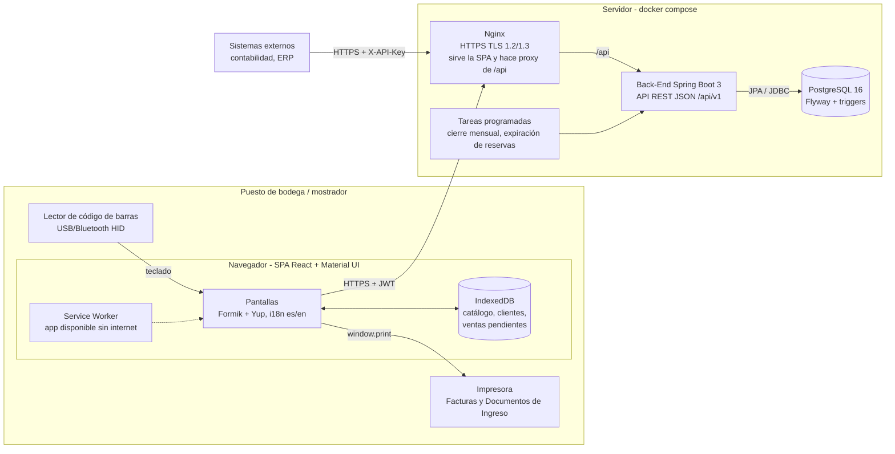
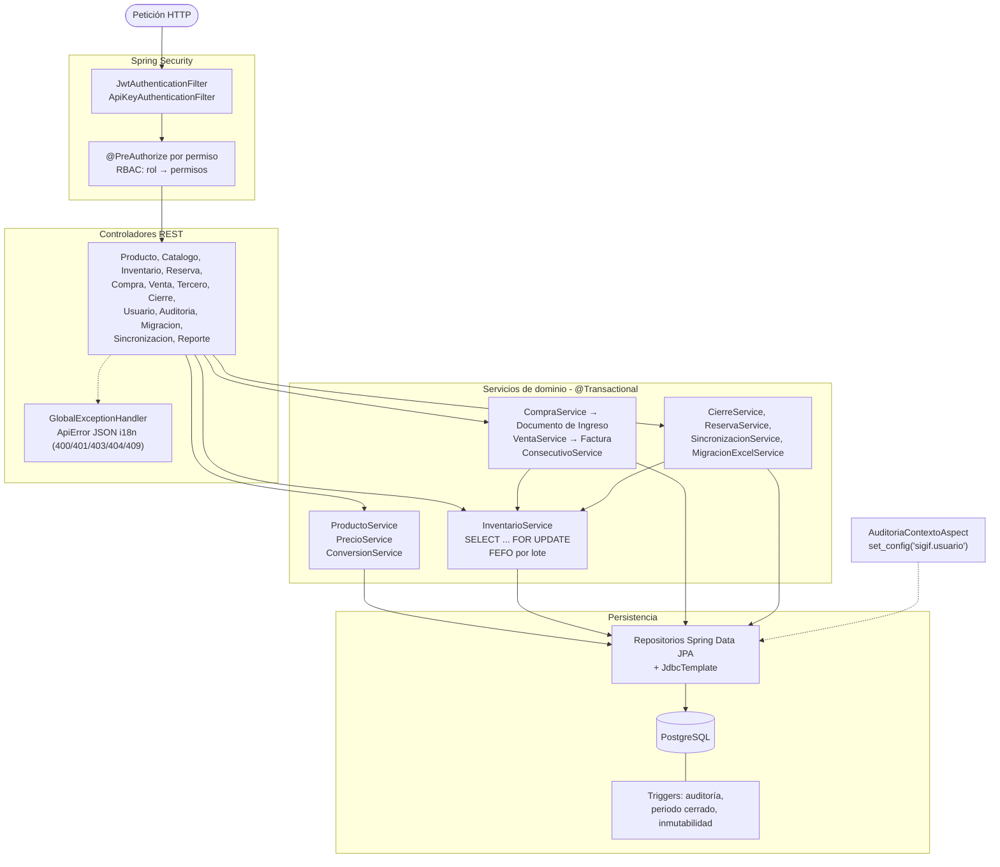
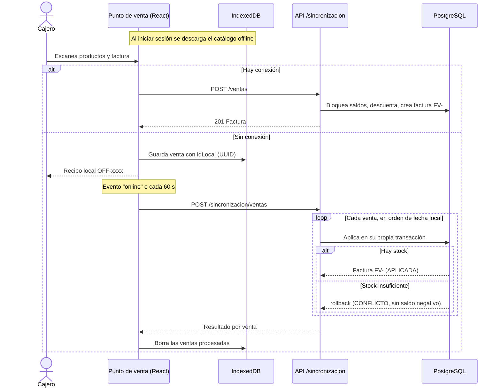

<!--
  Nombre: ARQUITECTURA.md
  Descripción: Diagramas de arquitectura de SIGIF: despliegue, capas del Back-End y flujo de venta offline.
  Fecha de creación: 21/10/2026
  Última actualización: 21/10/2026
  Autor: Equipo SIGIF
-->
# Arquitectura de SIGIF

## 1. Vista general y despliegue

## 2. Capas del Back-End

## 3. Venta sin internet y sincronización

