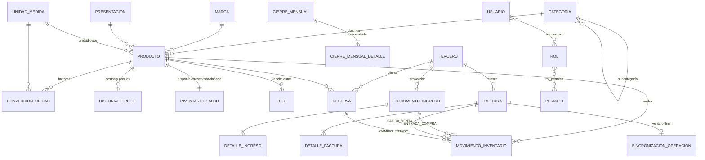

<!--
  Nombre: MODELO-DATOS.md
  Descripción: Modelo entidad-relación de la base de datos PostgreSQL de SIGIF.
  Fecha de creación: 21/10/2026
  Última actualización: 21/10/2026
  Autor: Equipo SIGIF
-->
# Modelo de datos (PostgreSQL 16)

Las migraciones Flyway en `backend/src/main/resources/db/migration` son la fuente de verdad:

- `V1__esquema_inicial.sql`: tablas, llaves, índices y restricciones CHECK (saldos `>= 0`, estados válidos).
- `V2__triggers_auditoria_y_reglas.sql`: triggers de auditoría, inmutabilidad y bloqueo de periodos cerrados.
- `V3__datos_iniciales.sql`: roles, permisos, unidades, presentaciones, consecutivos y terceros genéricos.

## Reglas garantizadas por la base de datos

| Regla | Mecanismo |
|---|---|
| RN-003 Código de barras único | `UNIQUE (codigo_barras)` |
| RN-006 Estados de inventario | Columnas `cantidad_disponible/reservada/danada` + `ck_mov_estados` |
| RN-008 Sin saldos negativos | `CHECK (cantidad_* >= 0)` en `inventario_saldo` y `lote` + `SELECT ... FOR UPDATE` en la aplicación |
| RN-001 Solo compras/ventas | `ck_mov_tipo` (`ENTRADA_COMPRA`, `SALIDA_VENTA`, `CAMBIO_ESTADO`) con documento soporte obligatorio |
| RN-011 Periodo cerrado | Trigger `fn_bloquear_periodo_cerrado` en movimientos, facturas y documentos de ingreso |
| RN-014 Auditoría universal | Trigger `fn_auditoria` (usuario, fecha, operación, valores anterior/nuevo en JSONB) en 23 tablas; `auditoria` es de solo inserción |
| Contraseñas | Solo `password_hash` BCrypt; los triggers excluyen `password_hash` y `api_key_hash` de la bitácora |

El usuario de aplicación llega a los triggers mediante `set_config('sigif.usuario', ..., true)` que ejecuta
`AuditoriaContextoAspect` al inicio de cada transacción de escritura.
